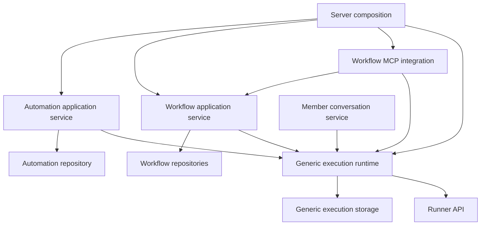
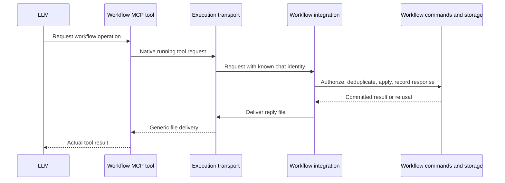

# Task lifecycle refactor

## Direction

A task performs LLM work and produces output. It must work without workflows, steps, schedules, webhooks, or approval rules. Automations decide when to request that work. Workflows decide how to use it. Their application services may coordinate those capabilities, but their requirements must not become task states, task triggers, or dependencies of the execution engine.

The first change is at the model boundary: remove the `step` variant of `Task.Trigger`. Removing a server import while keeping that variant would leave the source of the coupling intact. Remove the automation-source variant from task execution as well: the scheduling domain can record which task it started without teaching tasks about scheduling.

This is a replacement proposal based on the clarified boundary, not an extraction of the current lifecycle into shared helpers. It recommends eliminating the separate workflow-shaped task state machine, using existing generic execution facts, and moving associations and submission facts to their owners. The previous proposed `submitTask` and step-dependent `finishTaskExecution` API should not be implemented.

Only this document is changed for this investigation. The source baseline is `d0372de`, inspected on 2026-11-08. Other agents may edit the checkout; implementation must reread affected code and preserve their changes. This plan distinguishes observed behavior from proposals, includes intentional behavior changes, and claims no runtime verification.

## 1. Start with the models

### Current declarations and their leaks

| Model or contract                                                                                                        | Current facts                                                                                                                                   | Boundary assessment                                                                                                                                                                                                        |
| ------------------------------------------------------------------------------------------------------------------------ | ----------------------------------------------------------------------------------------------------------------------------------------------- | -------------------------------------------------------------------------------------------------------------------------------------------------------------------------------------------------------------------------- |
| [Task.ts](../../packages/contracts/src/models/Task.ts), `Trigger`                                                        | A task carries either an automation ID or a ticket ID, step ID, and step-automation ID.                                                         | The caller's identity and workflow relationship are embedded in generic work. The `step` literal at line 10 is the first explicit leak.                                                                                    |
| `TaskState` and `Outcome`                                                                                                | A task is active, submitted, or settled; settled outcomes are succeeded, failed, or cancelled.                                                  | Submission has workflow meaning. Success currently includes approval, while failure includes missing workflow submission and refused workflow tools. Different decisions share one state machine.                          |
| `Task`                                                                                                                   | Its only other data is `kind` and `chatId`. Agent selection, inputs, messages, runtime status, and disk already live in chat execution storage. | After removing caller identity and workflow state, there may be no independent task aggregate left to store. Do not retain an empty abstraction merely because a file exists.                                              |
| `Conversation` and `ChatOrigin`, also in `Task.ts`                                                                       | Member ownership and an optional workflow ID are declared alongside task data.                                                                  | Conversation ownership is valid chat data. Its workflow association belongs to workflows. The task module currently collects several callers' contexts.                                                                    |
| [Automation.ts](../../packages/contracts/src/models/Automation.ts)                                                       | Agent and prompt, interval/fixed-time/webhook activation, enabled state, next run, credentials, and last start error.                           | These are activation/configuration concerns. They need a generic start operation, not an execution engine that recognizes their trigger type. A webhook is an activation source even though the union is named `Schedule`. |
| [Workflow.ts](../../packages/contracts/src/models/Workflow.ts), `StepAutomation`                                         | A step has entries with an ID, agent ID, and instructions. Defaults are copied into actual ticket steps.                                        | This is workflow-owned configuration for automated contributions. It is not the same persisted entity as the global scheduled/webhook automation.                                                                          |
| `Workflow.automationsSubmitted`                                                                                          | It consumes task triggers and task submitted state to decide whether every configured automation contributed.                                   | The workflow owns the rule, but its facts are stored on the wrong side of the boundary. It should consume workflow-owned submissions.                                                                                      |
| [Agent.ts](../../packages/contracts/src/models/Agent.ts)                                                                 | A reusable LLM recipe, plus built-in workflow MCP names and `canWorkSteps`.                                                                     | Generic tools and model configuration belong here. Knowing the step tool's name or whether a workflow can use an agent belongs to the workflow/tool capability boundary.                                                   |
| [Chat.ts](../../packages/contracts/src/models/Chat.ts) and [Runner.ts](../../packages/contracts/src/resources/Runner.ts) | Generic input/runtime status and execution requests/updates, with native OpenCode messages, files, and completion.                              | Reuse these facts. Submission and approval do not need another execution protocol.                                                                                                                                         |

A pure rule is misplaced if it makes a generic concept depend on a consumer's requirements. Conversely, a workflow referencing an agent or generic task output is an intentional dependency. Assess the meaning of each field and operation before moving it to a shared package.

### Target meanings

| Concept                  | Owns                                                                                                                                    | May reference                                                                        | Does not decide                                                                                 |
| ------------------------ | --------------------------------------------------------------------------------------------------------------------------------------- | ------------------------------------------------------------------------------------ | ----------------------------------------------------------------------------------------------- |
| Agent                    | Reusable instructions, model, skills, tools, execution permissions.                                                                     | Canonical model and MCP configuration shapes.                                        | Workflow eligibility, approvals, activation.                                                    |
| Task                     | An instance of unattended LLM work, its input, activity, and output. It can receive further input using its existing execution context. | Agent configuration, input IDs, native messages, files, execution facts.             | Why it was started, which step receives its work, submission, approval, scheduling.             |
| Automation               | A repeatable request for an agent to perform work and the rules that activate it.                                                       | Agent identity and the identities/results of tasks it started.                       | Workflow progress or execution protocol internals.                                              |
| Workflow                 | Definitions, tickets, steps, people, fields, automated contributions, submissions, approval.                                            | Agent capabilities, task identities, generic execution/output facts.                 | VM lifetime, OpenCode synchronization, a task's execution outcome based on business acceptance. |
| Execution runtime        | Starting/continuing work, output persistence, input and tool-reply delivery, interruption, recovery of owed work.                       | Generic requests, native OpenCode shapes, storage, runner API.                       | Workflow commands, scheduling, submission requirements, workflow command authority.             |
| Workflow MCP integration | Exposing workflow commands to the LLM, authorizing each call in its bound context, returning the actual result.                         | Workflow operations, tool contracts, generic runtime identity, file/reply transport. | A parallel workflow implementation or a task failure policy for tool refusals.                  |

A task is not one VM lifetime. The existing runtime can consume more input and start another VM from the last saved disk. Keep that useful capability. An automation activation starts fresh work; workflow feedback can continue an existing work context. Both use generic execution operations.

## 2. Explicit orchestration and dependency direction

Application services may know several concepts when coordinating a use case. `WorkflowService` can load a step, build input, start a task, and save their association in one transaction. `AutomationService` can load a due automation, start work, record the run, and advance its schedule. The task engine does not need to know either caller's business concepts.

Dependencies in this diagram point from a consumer to the capability it uses:



The runtime exposes generic activity and a transport callback; application composition connects them to workflow integration. The runtime does not import its consumers. This is the existing kind of infrastructure boundary in `ChatExecutions.Receive`, not a new policy registry or a callback returning task states.

| Coordination                                                     | Permitted owner                                                    | Reason                                                                              |
| ---------------------------------------------------------------- | ------------------------------------------------------------------ | ----------------------------------------------------------------------------------- |
| Select agent, assemble workflow context, start/continue work     | Workflow application service                                       | It owns the use case and calls the generic execution capability.                    |
| Read/verify webhook, render prompt, request work                 | Automation application service and HTTP adapter                    | These are activation concerns; tasks receive the resulting input.                   |
| Associate a task with an automation or step                      | The domain creating the association                                | Generic execution remains usable by another consumer.                               |
| Require contributions, fields, and children before approval      | Workflow model and application service                             | The rule survives a change of execution backend.                                    |
| Authorize/apply workflow MCP requests                            | Workflow commands and MCP adapter                                  | They know the actor/work scope and current workflow state.                          |
| Persist input and mark execution owed together                   | Execution runtime through its repository                           | Every caller needs this invariant.                                                  |
| Commit task creation and its caller-owned association together   | Calling application service, using composable runtime transactions | No VM or notification starts before the enclosing transaction commits.              |
| Combine runtime/submission/step/permission facts into a response | Resource view and application query                                | A view intentionally composes facts; it does not create another task state machine. |
| Wire tool processing before execution recovery and activation    | Server composition                                                 | Initialization ordering belongs to the application, not a workflow-aware runtime.   |

Pure models do not load repositories or perform this orchestration. Handlers delegate use cases rather than coordinate VM cleanup or issue cross-domain SQL. The runner owns execution and generic transport, with no workflow commands or business acceptance rules.

### Useful relationships and unacceptable leaks

| Relationship                                                                              | Decision                       | Reason                                                                                          |
| ----------------------------------------------------------------------------------------- | ------------------------------ | ----------------------------------------------------------------------------------------------- |
| A workflow-owned association references an existing task `ChatId`                         | Keep                           | Real relationship, no reverse dependency; no need for a second ID with no independent lifetime. |
| Workflow code reads generic activity/output                                               | Keep                           | A consumer must observe the capability it uses and interpret its facts.                         |
| A task prompt mentions workflows, fields, and submission tools                            | Keep                           | Caller-prepared LLM input. The engine passes it through without deriving policy from it.        |
| Agent configuration includes workflow MCP tools                                           | Keep                           | Tool configuration is extensible; execution does not own the tools' business meaning.           |
| Workflow MCP adapter understands OpenCode tool parts                                      | Keep at that adapter           | Protocol translation belongs at the integration boundary, not in the workflow model.            |
| Workflow view says Approved; automation view says Succeeded                               | Keep                           | Business acceptance and normal runtime completion are different facts.                          |
| Chat list response carries a workflow name/backlink                                       | Keep as a resource view        | Composed response data does not require workflow state on the execution record.                 |
| Task contract contains a step variant or a renamed metadata bag that task code interprets | Remove                         | Renaming data does not change ownership.                                                        |
| Task code checks open tickets, assigned entries, or actionable steps                      | Remove                         | Workflow use cases and workflow command authorization own those checks.                         |
| Tool refusal directly fails a task; approval makes a task succeed                         | Remove                         | Workflow decisions are being used as execution outcomes.                                        |
| Generic chat storage owns workflow joins and MCP response codecs                          | Remove                         | It is maintaining another domain's queries and receipt contract.                                |
| Runtime copies a supplied tool-asset file map                                             | Keep                           | Generic setup; switching behavior on built-in workflow tool names is the leak to remove.        |
| Higher-level service depends on runtime and workflow repositories                         | Keep when it owns the use case | Isolation permits application coordination; it does not require separate processes or packages. |

## 3. Prefer one generic execution lifecycle

### Representation

Use the existing chat-backed runtime to implement tasks. Keep one canonical operational state and retained output; remove the additional `TaskState` mixing execution with submission and approval. Do not replace it with another generic-looking union carrying the same workflow-dependent semantics.

The current task has no independent identity, agent, or input data beyond its chat. The recommended simplification is to remove that aggregate after moving its caller-owned fields. Move the genuinely generic conversation/task distinction and member ownership to chat/execution metadata. Keep an unattended task marker for execution mode and access restrictions, with no automation/workflow/step variants. If `Task.ts` then has no independent concepts, delete it instead of preserving a wrapper around `ChatId`.

This does not remove the task capability: starting unattended work, continuing it, and reading its output remain useful operations. A separate task entity would be justified by an independent lifetime or data an actual caller needs; the inspected implementation does not establish that need. Do not add a new `TaskId`, execution-result ledger, or scheduler simply to preserve old module boundaries.

Use `Chat.status` and committed output as the initial canonical execution facts. The existing values describe owed/running work, idle execution, failure, and interruption. Null means idle, not independent proof of success: result derivation must distinguish completed output from a context that has never produced output. Do not infer a successful business result from a nullable status.

### Lifecycle

| Event                                               | Generic runtime behavior                                                                               | Consumer behavior                                                            |
| --------------------------------------------------- | ------------------------------------------------------------------------------------------------------ | ---------------------------------------------------------------------------- |
| Start                                               | Persist unattended work and input atomically; deliver after commit.                                    | Record its own association in the enclosing transaction.                     |
| More input while active                             | Queue/deliver through the existing input protocol; do not report completion while input is still owed. | Decide whether this follow-up is currently allowed.                          |
| Normal finish                                       | Preserve committed output and saved disk; report normal completion consistently for every task.        | Decide whether output satisfies its requirements.                            |
| Execution failure                                   | Report failure; keep the last valid output/context according to existing runtime rules.                | Apply its own attention/recovery policy without rewriting the runtime fact.  |
| MCP refusal                                         | Return a tool error; the LLM can correct its call or report the problem.                               | Keep workflow state unchanged by the refused operation.                      |
| Workflow submission                                 | No task-state transition; execution can finish and save disk.                                          | Store a workflow submission and recompute readiness.                         |
| Approval                                            | Do not synthesize task success.                                                                        | Complete step, close write scope, optionally stop unneeded execution.        |
| Rejection                                           | Further input uses generic continuation.                                                               | Invalidate old submission, record feedback, authorize the next work request. |
| Stop                                                | Interrupt and discard provisional output; retain committed history/last good disk.                     | Record blocking or withdrawal in its own domain.                             |
| Continue after completion, failure, or interruption | Accept new input in the retained context through generic rules; existing output remains history.       | Validate current authority, ticket/entry, and work request before posting.   |
| Explicit release/delete                             | Stop and clean up execution-owned resources.                                                           | Decide when the context/output is no longer needed.                          |

This deliberately removes settlement of the whole work context as the mechanism for approval. Completed execution output is historical fact; another input can produce another result. Reuse existing `InputId` and native message identities to refer to work and output. A workflow must not infer acceptance from the latest status of a context that has since received more input.

### Results, continuation, and retention

A result is retained LLM output, including native messages and explicitly exported artifacts. Normal completion establishes that an invocation finished, not that a business objective was met. An LLM can report inability to contribute and still finish its invocation normally.

Reuse native message/file shapes. Do not introduce mandatory JSON results or a parser that guesses which assistant paragraph represents success. Workflow field, comment, attachment, and submission commands already provide structured business results. A generic output-reading API may expose committed message references and execution facts; it must not return step fields or approval state.

Keep output reads separate from live/provisional message reads. The in-memory generated-file map is not a durable artifact store: an exported snapshot becomes a retained file only when stored and held through the existing attachment operations. Initially expose retained native output and already stored file references, without promising that every temporary VM export survives continuation or release.

Current settlement calls `chats.remove`, which marks a tombstone and later removes messages, inputs, attachment holds, and disk. That destroys reusable output and prevents generic continuation after completion. Remove automatic destruction on success. Initially retain committed output and disk until explicit release; storage retention can be decided separately. Do not add an unrelated retention framework, and report the resulting increase in retained storage.

Stop and deletion remain distinct. A workflow can pause execution while keeping the context it will continue. Its accepted field values, comments, and claimed files remain workflow-owned after the execution context is released.

An immutable one-shot task with a separately identified continuation is another possible design, but it would require a new identity/context model and a way to preserve history and workspace across attempts. The simpler recommendation here uses the existing resumable context. Do not accidentally promise both representations or copy a saved OpenCode disk to a new chat ID without addressing its native session/message identities.

## 4. Associations belong to the domain using the work

### Automation activation

Keep global automations responsible for scheduling, webhook activation, enabled state, prompt preparation, and start refusals. Scheduled, Run now, and webhook paths create generic work with the same execution semantics.

Replace the task's automation trigger with an automation-owned run association: automation ID, chat/task ID, and the time/order facts used by last-run queries. Save it through `AutomationRepository` in the activation transaction. The domain can report its runs without searching another domain's origin JSON.

Preserve atomic advancement of a due slot and creation of work. A refused start updates the automation's start error according to current behavior; a later execution failure is a run result, not the same error. Disabling an automation stops scheduled/webhook activation without retroactively deciding already started work's outcome. Preserve Run now's current independent behavior: it can run a disabled non-webhook automation.

`AutomationRepository.list` currently joins chat origins and chats and interprets `TaskState`. Return automation-owned facts and last-run identity instead. The application query obtains generic execution facts through their owner and derives the response beside `resources/Automations.ts`, without writing a new join against execution internals.

### Workflow automated contributions

Keep `StepAutomation` as workflow configuration: the agent and instructions contributing to a step. Do not force it into a global table requiring scheduling/webhook fields, or add a workflow variant to `Automation.Schedule`. Shared execution operations provide reuse without a universal activation model.

Introduce a workflow-owned association for an automation's work on an actual step. A working name is `StepAutomationRun`. It needs these facts:

- Ticket/step identity, the step-automation entry ID, and existing chat/task ID.
- Current work request's existing `InputId`, so rejection/continuation invalidates the previous submission without a new global generation identifier.
- The submission fact for that work request, including when it was accepted, and any explicit reported inability to contribute.
- Whether this association still authorizes writes after replacement, entry removal, cancellation, or completion.
- Creation/order facts required to select the current attempt and display history.

These are workflow facts, not copies of execution status. Read runtime failure from its owner and approval from the step. Record submission for the current work request once. Do not build another enum combining all execution, acceptance, and presentation states.

Use workflow/ticket repositories for association reads, writes, and collection constraints, exposing concrete methods for actual callers. Add a dedicated repository only if the association's query/write responsibilities justify its own module. Do not create a generic association service or have workflow code query chat-origin internals.

Change `automationsSubmitted` to consume workflow-owned submissions. Preserve contribution independence: an automation can submit while another person/automation, field, or child is incomplete. `stepCompletionRefusal` separately checks whether the shared step is complete enough to request approval.

### Member conversations bound to workflows

The optional `Conversation.workflowId` and chat repository workflow joins are related leaks. Move the association into workflow-owned conversation data. Keep the member owner in the generic conversation record; resolve workflow context/command authority at the workflow boundary.

Member history remains private to its owner, including after losing workflow access. New input and workflow commands still check current access and archival state. Automated step bindings must not inherit a member assistant's broader authority. Public visibility must not grant write permission. A step/task association also does not grant access to an unattended task through member-only chat RPCs; any workflow output view needs its own authorized projection.

Keep useful workflow names/backlinks in chat resource responses, composing them in application query code. A view may combine models; that does not justify a workflow ID on generic task/execution data.

### Do not merge all automation configuration by name

Global `Automation` and workflow `StepAutomation` both request LLM work, but their identities, ownership, editing, and activation differ. Sharing an agent ID and instructions does not require a universal automation entity. If configuring one reusable definition once and using it under several activation sources becomes a product requirement, a generic definition with consumer-owned activation records is a possible later design. It is unnecessary for removing today's task coupling.

## 5. Workflow MCP calls must return workflow results

### Current behavior and target

[step-tools.ts](../../apps/server/src/agent-tools/step-tools.ts) validates input, snapshots attachments, and returns `ok: true`. It does not ask T45 to apply the operation. `TaskService.saved` later consumes completed tool parts and invokes workflow hooks; a refused operation can then settle the task as failed. The MCP success response therefore does not prove that the business operation succeeded.

The target is a real request/response interaction: the tool requests a workflow command and returns T45's committed result or refusal to the LLM. Submission and reported inability are workflow operations; the task engine transports activity without interpreting them.

[WorkflowAssistant.ts](../../apps/server/src/workflows/WorkflowAssistant.ts) and [workflow-instance-tools.ts](../../apps/server/src/agent-tools/workflow-instance-tools.ts) already supply a useful pattern: observe a running tool request, authorize it on the server, record the result, and deliver a reply file to the waiting MCP process. Reuse that transport where suitable. New HTTP credentials, VM network access, or another RPC system are not prerequisites.

The bridge is transport. Its workflow adapter belongs with workflow integration, and file delivery remains a generic runner operation. A later direct MCP endpoint could replace it without changing task contracts or outcomes; this plan does not require that migration.

This bridge requires directly observable native tool parts. Keep the built-in bridged tools' existing `codemode: false` setting while using it. That restriction belongs in the tool catalog/integration, not in task business rules. Removing it without replacing the transport could hide the operations from T45.



Keep fields, comments, and attachments at this boundary. Rename `step_submit_task` to a name such as `step_submit_work`, describing a workflow submission. A tool such as `step_report_blocker` can replace the task-failing interpretation of `step_give_up`: record the contribution problem and notify its responsible person, without automatically blocking the shared step or declaring an execution failure. Update the contract, generated tools, prompts, adapter, callers, and existing tests together; do not add pre-release compatibility aliases.

### Authorization and freshness

Bind an automated call to the server-known chat, its current workflow association, automation entry, and work request. A step ID supplied by the LLM is not authority. Refuse another step, obsolete entry, closed scope, or stale work request.

When a retained context continues after rejection, the new input has a new existing `InputId`. Include that identity in workflow tool requests/context and validate it in the adapter. An operation from an earlier round must not become valid simply because the same chat is active again. This is workflow authorization state; the generic runtime continues handling ordinary input IDs.

The workflow orchestrator can choose the input ID before building the prompt, using the existing caller-chosen input protocol. It does not need a workflow context parameter in the task engine. Commit the relationship and current work request before input delivery. Existing request IDs identify individual tool operations; input IDs identify the work request they belong to. Do not conflate those purposes.

Member assistants keep member authorization. Automated contributions get only their bound step operations. Reuse workflow business operations, field validation, and transactions with the correct actor/scope; do not impersonate an administrator or bypass checks because the caller uses MCP.

After submission or reported inability, refuse further writes for that work request, as the existing inactive-task guard intends. Let the LLM finish and save disk. Rejection authorizes a later input; replacement/cancellation closes the old association. This scope is workflow state, never a generic task state called submitted.

### Receipts and files

Keep durable workflow operation receipts keyed by server-known chat and request ID, with the canonical request and saved response. Same ID with different arguments refuses; an authorized duplicate returns the stored response without repeating the write. A receipt must not bypass revoked access.

Separate authority to read a saved response from eligibility to perform a new mutation. A successful submission closes further writes for that work request, but a retry after lost reply delivery must still be able to retrieve that submission's stored acknowledgement when its caller remains authorized. Check the request identity/response access, replay an existing result when allowed, and enforce current mutation eligibility before any unrecorded operation. Do not reapply a command or return a different result merely because its own successful mutation changed eligibility.

Move `workflow_operation_receipts` queries and response codecs out of `ChatRepository`. The workflow storage/adapter owns them. Despite its name, `task_calls` is also a step-tool receipt ledger. Move that responsibility to the workflow boundary and remove its completed-tool consumption path when step tools use real request/response.

Reuse the request/response receipt pattern for step tools, removing the old ledger when unused. With a clean database baseline, permanent dual writes and replay adapters are unnecessary. Preserve call order and atomic acknowledgement of mutations and responses.

File snapshots and generic `file` updates can keep their transport convention. The workflow adapter decides whether bytes become a step attachment or field value. Reuse the runner-delivered bytes and existing attachment storage/validation; no workflow destination belongs in runner requests.

### Attachment handoff is a distinct protocol concern

The existing reader scans generated files when reading OpenCode messages and emits file updates before those messages. That ordering does not prove that a running tool's snapshot is ready: the tool may create the file after its running part is observed and then wait for a server reply. If the server waits for that file and no new OpenCode event arrives, the combined attach-and-wait operation can stall. This is a risk of the proposed conversion, not a reproduced defect in the current completed-snapshot tool. Do not rely on timing or add polling to make this conversion pass.

For the first implementation, prefer a two-phase attachment interaction that works with the existing transport: one tool prepares/exports the snapshot and completes, returning its file reference and name; a subsequent workflow attachment tool requests the committed attachment using that exported reference. The completed export gives the reader an observable event after the snapshot exists. The adapter validates that the reference belongs to the server-known execution and stores/claims its bytes before acknowledging the workflow mutation. It must never read an arbitrary host path supplied by the LLM.

This adds a tool call and changes the agent instructions/tool schema; include that cost in review. The preparation response acknowledges export only, while the attachment response acknowledges the workflow write. Preserve path containment, size limits, stable snapshot bytes, file-before-message ordering, and the workflow receipt's deduplication. Do not describe export as successful workflow attachment.

If a single combined attachment call is required later, first provide a proven generic file-readiness signal independent of further OpenCode events, or a direct upload transport. That would be a separately justified runner/transport change with scoped cleanup and observable readiness, not permission to teach the runner about workflow attachments. The preferred first implementation requires neither a new runner RPC nor a file-watching framework.

Prepare filesystem work outside SQL transactions where appropriate, then revalidate scope and apply database writes inside. Filesystem writes cannot be rolled back by SQL. Do not promise exactly-once preparation or add compensation machinery. A lost execution may already have committed a workflow operation; its receipt must survive deletion of provisional chat output.

## 6. Remove direct and transitive runtime dependencies

### A deleted import is insufficient

[TaskService.ts](../../apps/server/src/tasks/TaskService.ts) directly depends on `TicketRepository`, but its trigger/state model explains why. `canRun`, `transition`, chat-change forwarding, `saved`, and `receive` all contain consumer knowledge. It also depends on `ChatService`, whose construction and operations require workflow repositories and permissions.

Move the facts and decisions to their owners, then evaluate what remains. Do not rename `StepHooks` to generic hooks while passing the same lifecycle decisions through another callback. Do not retain a service that only forwards calls.

### Recommended runtime extraction

Keep [ChatExecutions.ts](../../apps/server/src/chats/ChatExecutions.ts) as the execution owner. Move genuinely generic transactional posting/stopping currently embedded in `ChatService` to that boundary, exposing one shared internal runtime to task and conversation callers. It should hide unattended startup, further input, interruption, output reading, and execution transport mechanics.

`ChatService` can remain the higher-level member API for ownership, workflow-bound conversation use cases, and composed views. Task callers must not depend on that member API. Move the remaining ID/input creation into generic startup and remove the old `TaskService` when it becomes a facade.

This adds no independent scheduler and preserves one owner per chat. All clients must share one runtime layer instance. A separate `ChatExecutions.make` per consumer would create competing owners and violate serialization.

### Execution preparation and tool assets

`ChatExecutions.requestOf` currently loads workflows, adds workflow instructions, and checks named built-in MCP servers before installing tools. Move workflow context preparation to application integration, preserving it for continued and recovered member conversations. Simply deleting that context would break assistants.

Effective instructions, MCP configuration, and asset maps are ordinary execution configuration. The runtime must not inspect workflow IDs, synthesize workflow prompts, or choose business behavior from built-in MCP names. Keep concrete workflow recipe preparation at application composition, without a registry of domain policies inside the runtime.

For bundled code, prefer the simple packaging option: supply the existing built-in bundle as a generic asset map, allowing configured MCP commands to choose what runs. The runner already copies such maps. Possessing a binary grants no workflow authority; the server binding does. This removes name checks without adding runner policy.

Move workflow MCP constants/capability checks out of the base agent model into the workflow/tool contracts. `canWorkSteps` has server workflow and frontend selector callers; retain one canonical capability decision at its correct boundary. The agent editor can keep offering tool presets through its catalog. Seeded assistant IDs belong with application/seed setup.

### Wiring, completion, and recovery

Keep the small generic `Receive` distinction between messages and execution end, or an equivalent existing transport interface. Application composition wires the MCP adapter and workflow completion observer once. They consume runtime facts and never return a requested task state.

The current receiver is deferred single registration, while chat initialization starts owed executions. Preserve the guarantee that requests cannot run before processing is ready. Composition must wire transport before releasing recovery and automation activation. Standalone runtime construction must need no workflow service/repository. Do not use an optional workflow flag, silently dropped requests, or a general event bus to solve startup ordering.

A workflow may react to normal completion without submission by recording a missing contribution and notifying its responsible person. Use the reliable completion path, not a lossy UI change stream as the only source of that business effect. The runtime reports the same completion whether any workflow observes it or not.

The existing completion callback runs inside the execution SQL transaction after any supplied disk is saved and output marked committed; SQL has not committed yet. Application composition can retain atomic completion-related database work through that generic callback. Workflow refusals are handled on the workflow side and do not rewrite execution outcomes; database defects still fail the transaction. A generic void-returning protocol callback is not a workflow lifecycle hook.

Move chat-change-to-step-view forwarding to workflow integration using its association lookup. It can invalidate a view and reread after a missed signal. Durable receipts/reliable completion remain responsible for business effects. Do not depend on a UI signal being delivered exactly once.

## 7. Schema and query ownership

| Current persistence                                     | Proposed ownership/change                                                                                                                        |
| ------------------------------------------------------- | ------------------------------------------------------------------------------------------------------------------------------------------------ |
| `chat_origins.trigger` and step/automation JSON indexes | Remove caller union; add concrete automation-owned and workflow-owned run associations.                                                          |
| `chat_origins.state`                                    | Remove workflow-shaped task state; retain canonical activity/output in execution storage.                                                        |
| `chat_origins.workflow_id`                              | Move to workflow conversation associations; keep member ownership in conversation data.                                                          |
| Kind inferred from nullable owner/trigger columns       | Use minimal explicit conversation/task kind or equivalent validated representation after removing trigger. Avoid ambiguous all-null origins.     |
| `task_calls`                                            | Replace its step-tool role with workflow request/response receipts; remove when unused.                                                          |
| `workflow_operation_receipts` via chat origins          | Preserve durability; move queries/codecs to workflow ownership and reference retained execution identity rather than removable origin internals. |
| Automation list querying chat origins                   | Read its own run association, then compose runtime facts through their owner.                                                                    |
| `ChatRepository.list` joining workflows                 | Read generic conversation facts, then compose workflow metadata in application query code.                                                       |
| Messages, sessions, inputs, disk, attachment holds      | Remain execution-owned. Completion/approval no longer implicitly deletes the reusable context.                                                   |

Keep foreign keys and uniqueness for real relationships. A workflow association referencing a retained chat row is legitimate relational integrity; it does not authorize chat storage to interpret steps. Ownership concerns interpretation and writes, not banning all cross-table references.

Repositories own association/receipt SQL and atomic collection writes. Application services own transactions spanning repositories and runtime operations. They call methods rather than copy foreign joins. Batch reads are appropriate for actual view callers, without inventing speculative repository options.

Edit [Schema.ts](../../apps/server/src/persistence/Schema.ts) in place for the pre-release baseline. Update codecs, constraints, indexes, and existing seeds together. No migrations, compatibility unions, fallback reads, or permanent dual representations. Use disposable state for verification; never remove the developer's `.t45` to make the new schema start.

## 8. Preserve guarantees; identify intentional changes

### Guarantees to preserve

- Due activation and schedule advance commit together; a refused start leaves no partial work association.
- Input deduplication/conflict detection retain existing identities. Continued input and its workflow request/submission update commit together.
- One execution owner per chat; no automatic retry of a failed invocation; recovery of execution still owed after restart.
- Stops discard provisional output while retaining the last good disk and pending inputs. File delivery precedes messages that reference files; tool replies do not require another OpenCode event.
- Workflow mutations and receipts commit together. Lost VM output cannot erase/repeat a committed write. Current permissions, field validation, private member history, and scope checks remain enforced.
- Contribution submission is independent of other participants and incomplete fields/children, while shared-step approval still checks those requirements.
- Approval/rejection belong to the responsible person acting on current workflow facts. Public visibility is separate from write permission.

### Intentional behavior changes

| Current behavior                                                                                         | Proposed behavior                                                                              | Reason                                                                  |
| -------------------------------------------------------------------------------------------------------- | ---------------------------------------------------------------------------------------------- | ----------------------------------------------------------------------- |
| Normal completion fails an active step task without submission.                                          | Runtime completion is uniform; workflow records missing contribution and remains unready.      | Submission belongs to the consumer.                                     |
| Submission changes task state.                                                                           | Submission changes the workflow work-request record.                                           | Task does not know a step exists.                                       |
| MCP returns success, then a refusal can fail the task.                                                   | MCP returns the actual committed result/refusal; LLM may recover.                              | Tool results must describe the operation applied.                       |
| `step_give_up` fails a task.                                                                             | Report a contribution problem; invocation may finish normally with that report.                | Business inability is distinct from execution failure.                  |
| Approval settles tasks as succeeded and removes chats.                                                   | Approval changes workflow state/scope, optionally stops execution, preserves output.           | Acceptance is neither runtime success nor retention policy.             |
| Generic completion makes a task permanently settled/deleted; submitted work is the resumption exception. | Generic continued work can reuse retained contexts after completion, failure, or interruption. | Continuation is an execution capability, not a workflow-only exception. |
| Task trigger provides run history and step identity.                                                     | Each caller owns its associations and current work request.                                    | New consumers should not extend task schemas.                           |

A submitted contribution may remain valid despite subsequent execution failure: its workflow writes already committed. An approved step may coexist with interrupted execution stopped because its work is no longer needed. Views must distinguish the facts rather than force a single success/failure decision.

These changes are observable architectural changes. Explain them in the eventual implementation description. Do not accidentally add automatic approval, retries, cancellation of siblings, or a requirement to wait for invocation completion before deciding on already submitted work.

## 9. Implementation sequence

### 1. Establish contract ownership

Deliver generic execution identity/activity/output, caller-owned associations, and workflow-owned submission/request facts. Remove task trigger variants and workflow state; retain useful composite responses. Locations: `models/Task.ts`, `models/Chat.ts`, `models/Workflow.ts`, `models/Agent.ts`, and affected tool/workflow/automation/chat resources.

Adapt the existing readiness test to workflow facts. Exit when a new execution consumer requires no task schema change and no reverse model dependency exists. Implement dependent schema/adapters in the same coherent slice if otherwise the tree would not compile; do not land unused helpers or half-converted contracts.

### 2. Move association and receipt storage

Deliver automation run links, workflow contribution/conversation bindings, current work requests, workflow receipts, and generic execution metadata without trigger/state JSON. Locations: `Schema.ts`, relevant domain repositories, `ChatRepository.ts`, and existing seeds. Remove replaced origin queries/indexes as callers move.

Exit after disposable verification of uniqueness, current-attempt selection, and rollback of activation/start plus association. No developer state reset, new server tests, or codec tests. Keep table constraints and caller methods owned by the proper repository.

### 3. Expose the generic runtime

Deliver one runtime directly used by task callers and the higher-level conversation API, with generic start/continue/stop/output and completed output retention. Locations: `ChatExecutions.ts`, generic portions of `ChatService.ts`, `TaskService.ts`, `bin.ts`, and the runner contract only if an actual generic configuration requirement is demonstrated.

Remove the old task service when it becomes a facade, preserve the execution loop/runner mechanics, and verify start/finish/failure/stop/continue without any workflow layers. Existing conversation privacy and execution tests still pass under adjusted composition. No transitive dependency through the member service remains.

### 4. Apply workflow MCP requests through workflow commands

Deliver actual tool results/refusals, bound current-work authority, workflow receipts, and submission/problem operations without task hooks. Locations: step tools, existing request/reply support, `WorkflowAssistant.ts` or a focused workflow tool adapter if actor scopes justify it, `WorkflowService.ts`, tool contracts/presets, and existing tool tests.

Exit when replay is harmless, changed arguments under the same request ID refuse, stale scope cannot mutate, and refusal reaches the LLM without generic task failure. Prove the completed-export-then-attach handoff without depending on event timing; reply delivery follows commit. Remove `StepHooks`, task-owned saved-call processing, and the obsolete ledger/consumer.

### 5. Rewire activation and workflow orchestration

Deliver domain-owned associations for every activation, workflow submission/readiness/approval/rejection, reliable completion observation for workflow attention, and composition wiring before recovery. Locations: automation/workflow services, workflow conversation/query code, capability consumers such as `workLogic.ts`, seed setup, and `bin.ts`.

Exit when standalone scheduling/webhooks operate independently; workflow feedback and Run again use generic execution; withdrawn/prior-request calls refuse; attention effects are not duplicated; recovery cannot emit an unhandled tool request. Preserve member assistant access and current workflow permissions.

### 6. Compose views and remove obsolete concepts

Deliver workflow views from contribution/runtime facts, automation views from activation/runtime facts, and chat workflow metadata at application query boundaries. Locations: relevant resources and queries, obsolete exports/helpers/codecs/indexes, fixtures, titles, and tool prompts. Remove the old `Task.ts` representation if no independent concept remains.

Exit after affected tests/pre-commit and source checks for old triggers, task settlement on approval, step hooks, runtime workflow lookups, and task-owned MCP interpretation. Report code/API delta and unverified cases. No Submitted/Approved state remains in the generic runtime.

Each increment must execute coherently. Temporary adapters are limited to an unmerged implementation slice and removed before completion. Coordinate shared workflow edits with the other agent; do not absorb unrelated field-completeness, permission-view, template-language, or runner synchronization refactors.

## 10. Verification and known gaps

Existing tests establish some behavior, not correct ownership. The current workflow readiness fixture explicitly builds task triggers/submitted states; it must change because it encodes the boundary being removed.

| Existing coverage                                                                                                                                                 | Retain/adapt                                                                                                 | Limit                                                                                     |
| ----------------------------------------------------------------------------------------------------------------------------------------------------------------- | ------------------------------------------------------------------------------------------------------------ | ----------------------------------------------------------------------------------------- |
| [Workflow.test.ts](../../packages/contracts/src/models/Workflow.test.ts)                                                                                          | Readiness with workflow facts, workflow invariants.                                                          | No direct runtime/MCP orchestration coverage.                                             |
| [ChatService.test.ts](../../apps/server/src/chats/ChatService.test.ts)                                                                                            | Privacy, ownership, input validation/deduplication, agent availability, task starts via generic runtime.     | Its existing layer includes workflows; passing does not prove isolation.                  |
| [ChatExecutions.test.ts](../../apps/server/src/chats/ChatExecutions.test.ts)                                                                                      | Native output, disk, failure, stopping, pending input, recovery; adapt composition.                          | Mainly conversations, not contribution acceptance.                                        |
| [AutomationService.test.ts](../../apps/server/src/automations/AutomationService.test.ts) and [webhook.test.ts](../../apps/server/src/automations/webhook.test.ts) | Due-slot rollback, schedules, start refusals, webhook checks, fresh work per activation; adapt associations. | Do not establish workflow independence alone.                                             |
| [step-tools.test.ts](../../apps/server/src/agent-tools/step-tools.test.ts)                                                                                        | Adapt protocol/file assertions to real replies; preserve path containment and isolated injected assets.      | Unconditional-success assertions are obsolete; no server authorization/application proof. |
| [e2e/tests/app.spec.ts](../../e2e/tests/app.spec.ts)                                                                                                              | Keep the development-app smoke check.                                                                        | No lifecycle coverage. Do not enlarge E2E setup for this refactor.                        |

The source cleanup prompt forbids new tests. Adapt existing ones for changed representations/behavior; do not add permanent suites or hide a new suite in an unrelated file. Use disposable verification for uncovered integration guarantees, reporting gaps explicitly. If permanent coverage is authorized later, pure workflow rules belong in model tests and user behavior at the frontend integration boundary.

### Explicit implementation checks

| Check                          | Required observation                                                                                                                                                                                                        |
| ------------------------------ | --------------------------------------------------------------------------------------------------------------------------------------------------------------------------------------------------------------------------- |
| Runtime isolation              | Start, finish, fail, stop, continue, and read unattended output without workflow/activation repositories, services, types, or named-tool policy.                                                                            |
| Activation independence        | Interval, Run now, and webhook paths record their own run link and preserve scheduling/refusal behavior.                                                                                                                    |
| Atomic start                   | Failure before caller transaction commits leaves no input, association, schedule advance, or launched execution.                                                                                                            |
| Uniform completion             | Same runtime completion without a workflow, with missing submission, and after accepted submission.                                                                                                                         |
| Independent acceptance         | Normal execution can leave contribution missing; submission can survive execution failure; approval never rewrites runtime status.                                                                                          |
| Actual tool response           | Refusal reaches LLM as MCP error; accepted operation returns its committed result.                                                                                                                                          |
| Attachment protocol            | Export completes before attachment references it; delivered bytes are the snapshot, an unknown reference refuses, and the attach response follows its database commit without waiting on an event the tool itself prevents. |
| Receipt deduplication/rollback | Duplicate does not repeat writes; changed arguments under same ID refuse; rollback leaves no false success receipt or partial mutation.                                                                                     |
| Scope freshness                | Different step, removed entry, closed ticket, replaced task, or prior rejected input cannot mutate work.                                                                                                                    |
| Continuation                   | Submit, finish/save disk, reject, continue with new workflow input identity and same generic context; committed files/history remain usable.                                                                                |
| Stop versus release            | Block/stop retains context; explicit release removes only execution-owned resources and preserves claimed workflow files/values.                                                                                            |
| Multiple contributions         | Submission is independent; approval still checks all required contributions, fields, children; reported problems do not cancel siblings.                                                                                    |
| Private access                 | History remains owner-private; new commands lose authority when access is revoked; public visibility and automated scope do not grant administrator writes.                                                                 |
| Startup/recovery               | Wire processing before recovered/due requests; business completion effects do not rely on exactly-once UI signals.                                                                                                          |
| Retention                      | Generic output stays readable after completion; approval and later release do not erase workflow-owned results.                                                                                                             |

Use disposable state and the existing fake runner/persistence support. Await tool responses, receipts, stream events, or fake completion. No sleeps, polling, real external agent dependency, or new fixture framework. Source tracing is not an executed check.

Run affected existing tests through the task graph to supply their runtime bundle:

```sh
vp run --no-cache --filter @t45/contracts test
vp run --no-cache --filter t45 test
vp run --no-cache --filter @t45/web test
```

`@t45/core` has no test task; cover its changed exports with its existing typecheck task and affected consumers. After implementation run `vpr pre-commit` with the development app available. Change no setup/build dependencies or E2E server ownership for this refactor. Existing generic runner contracts should suffice; isolate and explain any newly demonstrated runner need.

No application tests or runtime checks run for this planning-only rewrite.

## 11. Code surface and completion criteria

This is wider than a three-file helper extraction: the model leaks into persistence, tool contracts, conversation preparation, and views. The inspected baseline is 47 lines in `Task.ts`, 213 in `TaskService.ts`, 1558 in `WorkflowService.ts`, and 213 in `WorkflowAssistant.ts`. These are baseline counts, not predicted savings.

Expected removals: caller trigger union; task submission/approval settlement; `StepHooks`; task-owned receipt consumption and ticket-change forwarding; runtime workflow lookups; workflow response codecs in chat storage; the separate task service if reduced to a facade. Expected additions: domain-owned associations/queries, real step MCP responses, and application composition using the generic runtime independently.

A new adapter/repository earns its module by owning actual protocol/storage complexity. Reuse the runtime, native OpenCode types, concrete repository methods, and small application composition. Do not introduce a universal result processor, event-sourcing framework, policy engine, trigger plugin system, or shared orchestration service.

Report total production line/file changes, exported API changes, independent decisions removed, storage-retention effects, intentional behavior changes, and verification actually performed. Line reduction is a bonus; moving identical coordination into opaque helpers is not a reduction.

The boundary is achieved when another LLM task consumer can be added without changing task types, outcomes, or runner behavior; execution works without workflow/scheduling services; and submission/approval rules can change without editing execution. Cross-domain knowledge is explicit in application orchestration, workflow MCP integration, and composed views.

The workflow owns whether work is useful and accepted. The runtime owns running it and retaining what it produced.
